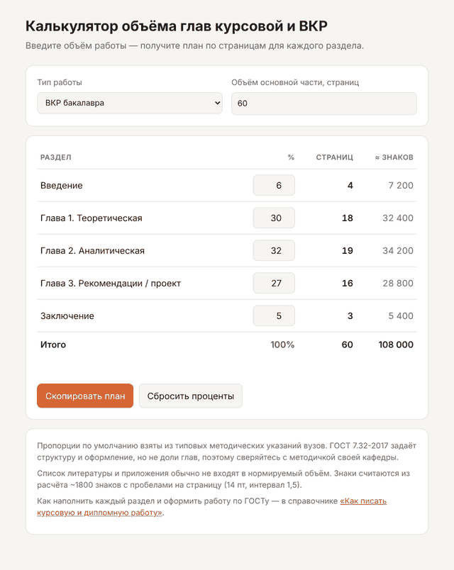

# Калькулятор объёма глав курсовой и ВКР

Простой офлайн-инструмент на HTML/JS. Он помогает распределить страницы между разделами курсовой работы или выпускной квалификационной работы (ВКР) ещё до того, как вы начали писать.

Вы вводите требуемый объём работы, а калькулятор показывает рекомендуемое число страниц для введения, глав и заключения.

**Онлайн-версия:** [calc.foxstudy.ru](https://calc.foxstudy.ru/) — открывается в браузере, ничего устанавливать не нужно.



---

## Зачем это нужно

Самая частая претензия научного руководителя к структуре звучит не «плохо написано», а «перекос». Например, теоретическая глава занимает 40 страниц, практическая 8, а введение растянуто на 6 страниц из 30. Такие перекосы проще предотвратить на этапе плана, чем исправлять за неделю до сдачи.

Калькулятор не пишет текст и не проверяет его. Он делает одну вещь: превращает «объём 50–60 страниц» в понятный план по разделам.

## Что важно знать про «нормы по ГОСТу»

Здесь часто путаются, поэтому коротко:

- **ГОСТ 7.32-2017** задаёт структуру и оформление отчёта о НИР. Большинство вузов опираются на него в требованиях к курсовым и ВКР: поля, шрифт, нумерация, оформление заголовков, рисунков и таблиц.
- **ГОСТ Р 7.0.100-2018** регулирует библиографическое описание, то есть то, как оформлять список литературы.
- **Пропорции глав ГОСТ не задаёт.** Их устанавливают методические указания вашего вуза или кафедры. Калькулятор использует типовые пропорции из распространённых методичек, но все проценты можно изменить вручную.

Если методичка кафедры противоречит значениям по умолчанию, права методичка.

## Значения по умолчанию

| Раздел | Курсовая | ВКР бакалавра | Магистерская |
|---|---|---|---|
| Введение | 8% | 6% | 5% |
| Глава 1 (теоретическая) | 40% | 30% | 28% |
| Глава 2 (аналитическая / практическая) | 47% | 32% | 32% |
| Глава 3 (рекомендации / проект) | — | 27% | 30% |
| Заключение | 5% | 5% | 5% |
| **Объём по умолчанию** | 30 стр. | 60 стр. | 80 стр. |

Список литературы и приложения в расчёт не входят: они идут сверх основного объёма.

## Возможности

- выбор типа работы: курсовая, ВКР бакалавра, магистерская диссертация;
- ручная настройка процентов для каждого раздела;
- пересчёт в целые страницы (сумма всегда сходится с общим объёмом) и примерное число знаков (~1800 на страницу при 14 пт и полуторном интервале);
- проверка, что сумма процентов равна 100%;
- копирование плана в буфер обмена;
- работает без интернета, без сборки и без зависимостей.

## Запуск

```bash
git clone https://github.com/foxstudy-ru/vkr-chapter-calculator.git
cd vkr-chapter-calculator
# откройте index.html в браузере
```

Либо откройте [онлайн-версию калькулятора](https://calc.foxstudy.ru/).

## Что дальше: от плана к тексту

Калькулятор отвечает на вопрос «сколько писать». Вопросы «что и как писать» он не решает: как сформулировать актуальность, объект и предмет исследования, как оформить ссылки и список литературы по ГОСТ Р 7.0.100-2018, как подписывать рисунки и таблицы.

Эти темы подробно разобраны в открытом справочнике [«Как писать курсовую и дипломную работу: структура и оформление по ГОСТу»](https://foxstudy.ru/kak-pisat/). Там собраны примеры введений, шаблоны формулировок цели и задач и типичные ошибки, из-за которых работу возвращают на доработку.

## Участие

Pull request'ы приветствуются, особенно:

- пресеты пропорций из методичек конкретных вузов (укажите источник);
- английская локализация;
- экспорт плана в .txt/.md.

## Лицензия

MIT

---

Справочник поддерживает команда [Fox Study](https://foxstudy.ru/).
